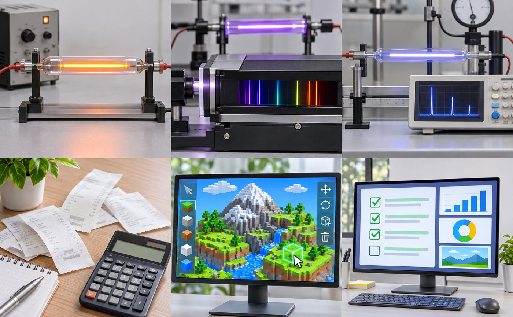

# Gemini 4 na prática

[PT](README.md) · [EN](README.en.md) · [ES](README.es.md)

## O que é

O projeto reúne fontes públicas, um comparativo e uma régua de validação para escolher entre Gemini 4 Neon, Argon e Hydrogen em tarefas do seu dia. Você precisa apenas de um navegador para ler o guia.

[Como começar](https://inematds.github.io/gemini-4-na-pratica/guia/) · [Leia o comparativo com fontes (em português)](COMPARATIVO.md)

[Assista à análise e ao resumo](https://www.youtube.com/watch?v=iP57IDdL7e0) · [Ver o Short no YouTube](https://youtube.com/shorts/WEWkoZKwEcU)

## Teste com algo que você precisa entregar

> Use os mesmos comprovantes fictícios nos três modelos. Peça uma tabela com ID, data e valor. Marque duplicatas e itens sem valor. Confira o total e registre o tempo até a entrega validada.

## Instalação técnica

O guia é HTML estático. Abra o arquivo abaixo em um navegador. O laboratório e o comparativo completo estão em português. [HTML](guia/index.html)

## O processo, do início ao fim

Dê aos três modelos os mesmos dados, ferramentas e limite de tentativas. Combine antes o que conta como pronto. Some o custo de todas as tentativas e divida apenas pelo número de entregas que passaram.

- [Laboratório completo (em português)](laboratorio/protocolo.md)
- [Baixar planilha CSV](laboratorio/tentativas.csv)
- [Tarifas publicadas pelo Google](https://aistudio.google.com/docs/pricing)
- [Índice geral de agentes](https://arena.ai/leaderboard/agent)
